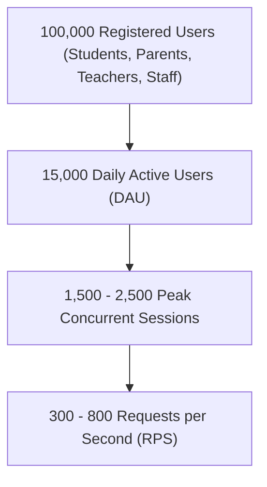
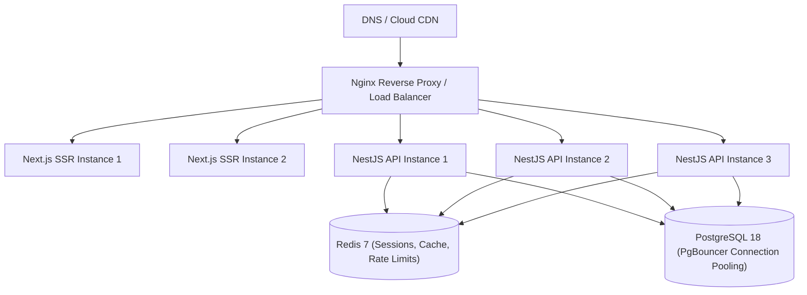

# Performance & Scaling Architecture (100,000 Users)

## 1. Capacity & Workload Model

Designing for **100,000 registered users** requires distinguishing total registrations from concurrent peak active sessions:



### 1.1 Concurrency Metrics
- **Peak Hours**: Morning check-in (attendance) and exam result publication days.
- **Target SLA**:
  - p95 Response Time: < 300ms
  - p99 Response Time: < 800ms
  - API Error Rate: < 0.1%

---

## 2. Horizontal Scaling Architecture



### 2.1 Stateless Application Tier
- Both Next.js (frontend) and NestJS (backend) containers are completely stateless.
- Session tokens are self-contained JWTs; ephemeral data and rate-limiting counters reside in shared Redis clusters.
- Instances scale horizontally behind standard reverse proxies or Kubernetes ingress controllers.

### 2.2 Database Connection Pooling with PgBouncer
- Direct connections from multiple Node.js processes can quickly saturate PostgreSQL's process limit.
- PostgreSQL connection limits are configured with transaction-level pooling via PgBouncer:
  - Database pool size per instance: 20–30 connections.
  - Query timeouts enforced at 5,000ms.
- Composite indices (`schoolId, status`, `studentId, date`, `organizationId, code`) prevent sequential table scans.

### 2.3 Redis Caching Strategy
- High-read, low-churn datasets (e.g. permission catalogs, school profiles, academic terms) are cached with short TTLs (5–15 minutes).
- Cache keys are strictly tenant-scoped (e.g. `tenant:{orgId}:schools`).
- Dynamic cache invalidation occurs immediately upon state-changing mutations.

---

## 3. Load Testing Verification

Load tests are defined in `scripts/load-test.k6.js` and can be executed via:

```bash
k6 run --vus 500 --duration 5m scripts/load-test.k6.js
```
The script validates response time thresholds (p95 < 300ms, error rate < 1%) under simulated multi-stage ramps.
