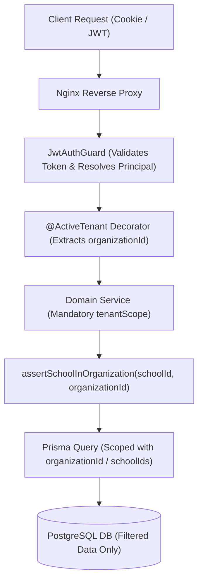

# Multi-Tenant Isolation Architecture

## 1. Overview

The School Management System implements logical multi-tenancy at the application and database layers. Multiple independent educational organizations, school boards, private school networks, and standalone campuses share the same compute and database infrastructure while maintaining strict tenant isolation.



---

## 2. Fundamental Tenancy Principles

### 2.1 Server-Derived Tenant Context
- `organizationId` and active `schoolId` are **never** trusted from client request bodies, query strings, or URL path parameters.
- The server extracts the authenticated `Principal` from the validated JWT claims.
- The `@ActiveTenant()` parameter decorator delivers a validated `TenantContext`:
  ```typescript
  export interface TenantContext {
    userId: string;
    organizationId: string;
    schoolId?: string;
    campusId?: string;
  }
  ```

### 2.2 Mandatory Tenant Scoping in Data Access
- Every service method enforces tenant isolation before executing queries or mutations.
- Multi-record queries always inject:
  ```typescript
  where: {
    school: { organizationId },
    ...
  }
  ```
- Cross-tenant record references (e.g. attempting to enroll a student in School B while authenticated to School A) trigger an immediate `DomainException('INVALID_SCHOOL', HttpStatus.BAD_REQUEST)`.

### 2.3 Anti-BOLA / IDOR Verification
- Broken Object-Level Authorization (BOLA / IDOR) is systematically prevented.
- A user attempting to access `/api/v1/students/:id` will receive a `404 Not Found` if the student belongs to a different organization, even if the UUID exists in the database.

---

## 3. Defense-in-Depth Verification

To eliminate data leakage, multi-tenant boundaries are validated at 3 levels:
1. **Network & Proxy**: Rate limiting per tenant IP and domain routing.
2. **Guards & Policies**: NestJS `PermissionsGuard` and role resolution.
3. **Repository / ORM Level**: Query criteria restricted by organizational membership.
