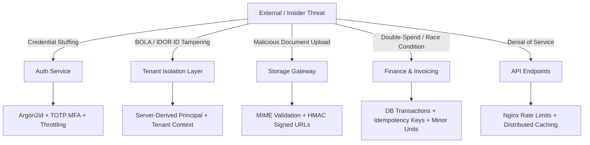

# Threat Model & Risk Assessment

## 1. STRIDE Threat Model

This threat model identifies key threat actors, assets, attack vectors, and mitigations across the SMS architecture.

---

## 2. Risk Matrix & Mitigations

| Threat Category | Asset at Risk | Attack Vector | Mitigation in SMS |
| :--- | :--- | :--- | :--- |
| **Spoofing** | User Identities | Credential stuffing, session hijacking, replay attacks | Argon2id password hashing, rotating refresh tokens with reuse detection, TOTP MFA, signed cookies. |
| **Tampering** | Grades & Finances | Man-in-the-middle, parameter tampering, race conditions | TLS 1.3, atomic PostgreSQL transactions, integer minor units, immutable audit logs. |
| **Repudiation** | Disciplinary & Financial actions | User claims action was performed by someone else | `@Audit` interceptor records actor ID, IP address, timestamp, and entity diff. |
| **Information Disclosure** | PII & Health records | Cross-tenant data leakage (IDOR), log exposure | Mandatory server-side tenant scoping, Pino logger PII redaction, short-lived HMAC signed URLs. |
| **Denial of Service** | API Availability | Volumetric HTTP flooding, expensive unindexed queries | Nginx limit_req zones, Redis cache layers, server-side pagination with maximum limits (100 rows). |
| **Elevation of Privilege** | Administrative Controls | Client injecting higher role or modifying JWT claims | Cryptographically signed JWTs, server-side role-to-permission mapping, RBAC guards. |

---

## 3. High-Risk Workflows

### 3.1 Financial Mutations (Invoicing & Payments)
- **Risk**: Double charging, duplicate webhook executions, negative balance exploits.
- **Mitigation**: All payment processing executes within `prisma.$transaction`. Invoices validate that payment amounts never exceed remaining balance (`EXCESS_PAYMENT`). Idempotency keys prevent duplicate executions.

### 3.2 Student Examination Results & Grade Publishing
- **Risk**: Premature disclosure of exam questions, post-publish tampering with student grades.
- **Mitigation**: Exams remain in `DRAFT` status until explicitly published via `POST /examinations/:id/publish` (protected by `grade:publish` permission). Attempts record server-authoritative timestamps.
